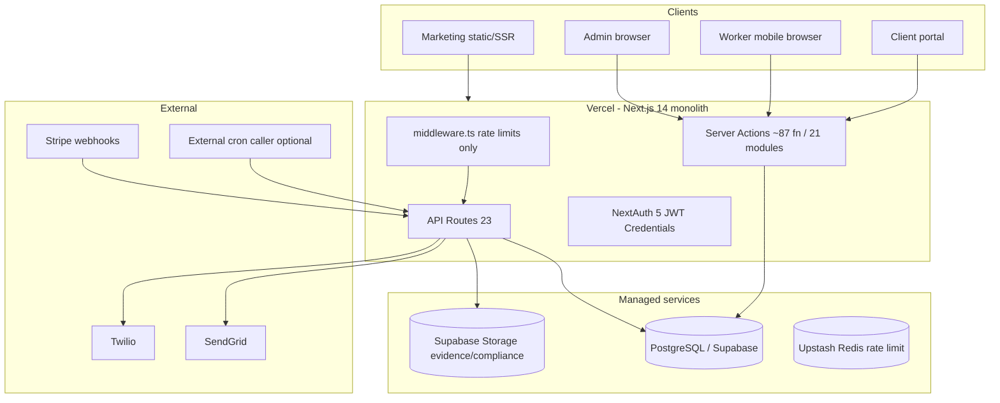
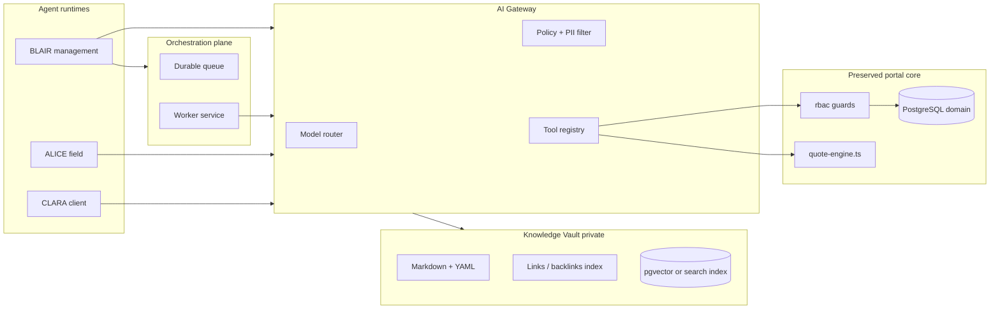

# BLVCKSHELL — Architecture & AI Integration Feasibility Audit

**Date:** 2026-10-26  
**Auditor stance:** Independent CTO review (code-first; READMEs used only for cross-check)  
**Scope:** `Blvckshell-Prop` / `portal/` on **`main`** @ `5656526` (Phase 5 marketing merged)  
**Instruction:** Research only — no rebuild, migration, or major implementation in this phase.

---

## Executive recommendation

**Choose OPTION B — Major architectural refactor** (preserve validated domain + data model; redesign AI/orchestration and progressively replace frontends).

| Option | Weighted score (1–5) | Verdict |
|--------|----------------------|---------|
| A — Extend monolith | **2.6** | Fast start, poor fit for durable AI + mobile scale |
| **B — Refactor + modular services** | **4.1** | **Recommended** |
| C — Full portal rebuild | **2.9** | High regression and migration cost; unjustified given working ops core |

**Why not rebuild (C):** The portal already encodes non-trivial business IP: server-authoritative quote engine (`src/server/pricing/quote-engine.ts`), job/checklist/evidence lifecycle, invoicing/tax freezing, payout uniqueness, audit log, notification outbox. Rebuilding throws away proven constraints and tests for marginal greenfield benefit.

**Why not extend-only (A):** Long-running multimodal pipelines, proactive BLAIR automation, and knowledge-graph RAG do not fit Vercel serverless timeouts and stateless routes. Stuffing agents into Next.js server actions increases coupling and security blast radius.

**Why refactor (B):** Keep PostgreSQL + Prisma domain, pricing, and RBAC patterns; add a **durable orchestration plane** (queue/worker), **AI gateway** (provider-agnostic), **Knowledge Vault** (private, non-Git), and **role-scoped agent runtimes** (BLAIR/ALICE/CLARA). Refactor worker UI into a mobile-first shell without rewriting billing.

---

## 1. Current system architecture

**Verified facts**

- Single deployable: `portal/` — marketing `(marketing)/*`, `admin/*`, `(worker)/*`, `(client)/client/*` (see `CTO_REPORT.md`, `AGENTS.md`).
- **No AI/LLM/embedding code** in repo (grep: no OpenAI/Anthropic/pgvector usage in application code).
- **Middleware** (`src/middleware.ts`): rate limiting only — **not** RBAC at edge.
- **Auth:** NextAuth v5 beta, JWT session 24h, credentials + bcrypt (`src/lib/auth.ts`).

---

## 2. Technology stack assessment

| Layer | Choice | Assessment |
|-------|--------|------------|
| Framework | Next.js 14.2 App Router | Mature for marketing + CRUD; **weak for long AI jobs** on serverless |
| ORM | Prisma 7 + PostgreSQL | **Strong** — 43 models, 31 migrations, partial indexes |
| Auth | NextAuth beta + enum roles | **Operational but fragile** — FOUNDER vs ADMIN inconsistencies |
| Storage | Supabase service role | **Adequate** for evidence; verify path conventions |
| Tests | Vitest + 3 Playwright specs | **Thin** vs domain complexity; worker E2E stale |
| PDF | pdfkit invoice route | **Single-purpose** — not proposal/contract engine |
| Client ML | TensorFlow.js in worker camera | **Heavy** for field devices; privacy-positive (local redaction) |

**Dependency risk:** NextAuth 5 beta, large client bundle on worker path (`EvidenceCameraCapture.tsx` + TF).

---

## 3. Feature inventory (implementation status)

| Capability | Status | Evidence |
|------------|--------|----------|
| Marketing site + leads | **Operational** | Phase 5 on `main`; `/api/lead`, outbox |
| Admin CRM (clients/sites) | **Operational** | Server actions, admin pages |
| Job lifecycle + state machine | **Operational** | `src/lib/state-machine.ts`, tests |
| Checklist runs + evidence | **Operational** | `ChecklistRun`, `JobDetailClient.tsx`, upload API |
| Quotes + walkthrough UI | **Operational** | `admin/quotes/*/walkthrough`, `quote-actions.ts` |
| Pricing engine | **Operational authoritative** | `quote-engine.ts` — server-only math |
| Invoicing + Stripe | **Operational** | Invoice PDF, webhooks |
| Payouts / payroll | **Operational** | Atomic batch finalize; integration tests |
| Recurring schedules → jobs | **Partial** | `generateJobsFromSchedules` — **manual admin**, no cron in repo |
| Work orders | **Partial** | DB + bulk transitions; **no create/detail UI** |
| Finance snapshots / investor pack | **Partial** | Models + admin list; copy says wiring incomplete |
| Versioned templates (Site/Job/Contract…) | **Schema ahead of UI** | Prisma models; runtime uses `ChecklistTemplate` |
| Notifications | **Partial** | Outbox solid; processor **marks SENT without providers** in dev; `CRON_SECRET` optional |
| Client portal | **Minimal** | Read-only jobs/invoices |
| AI / agents / knowledge graph | **Absent** | — |
| Offline worker / PWA | **Absent** | No service worker strategy |
| One-Sweep upload pipeline | **Absent** | Walkthrough is **manual** area lines, not photo/OCR package |

---

## 4. Database & domain model (One-Sweep relevance)

**Reusable today**

- `ClientOrganization`, `Site`, `Quote`, `QuoteAreaLine`, `QuoteSnapshot`, `PricingPolicy`, `RateCard`
- `ChecklistTemplate` → `ChecklistRun` (property-specific execution)
- `Contract`, `Invoice`, `SitePerformanceSnapshot`, `SiteSupplyAllocation`
- `AuditLog`, `NotificationOutbox`

**Missing for One-Sweep**

- **Walkthrough package** entity (upload session, source files, OCR status, human review flags)
- **Property profile** beyond `Site` scalar fields (area inventory graph, surface types, linked media)
- **Assumption / uncertainty** records (AI-proposed vs human-confirmed measurements)
- **Regeneration graph** (which artifacts depend on which inputs — frequency, rates, dimensions)
- **Document generation** artifacts (proposal/contract **versions** tied to quote snapshot IDs)
- **Receipt intelligence** (supplier invoices, duplicate hash, GL mapping)

**Important:** Deterministic pricing must remain in `computeQuoteSnapshot` — AI may **propose** area lines; engine **validates** gates (`passesBaseGate`, `passesStressGate`, etc.).

---

## 5. Frontend / mobile assessment

**Worker (`(worker)/*`)**

- **Pros:** Bottom tab nav (`WorkerNav.tsx`), `pb-20` safe area, single-column job flow, in-app camera + redaction gate on upload.
- **Cons:** `JobDetailClient.tsx` ~600 lines mixing checklist UX, legacy JSON path, fetch refresh; **no offline queue**; TensorFlow bundle weight; completed job view shows file types not thumbnails (`jobs/[id]/page.tsx`); placeholder `tel:` in nav.
- **Verdict:** **Refactor UI layer** (component split, optimistic offline queue, optional native wrapper later) — **do not** throw away server checklist model.

**Admin**

- Desktop-oriented dense tables — acceptable for BLAIR/management; not for ALICE.

**Client**

- Thin — suitable seed for CLARA **if** scoped queries enforced server-side.

**PWA:** Not configured for installable/offline-first field use.

---

## 6. Security & authorization (AI readiness)

| Control | Current | AI gap |
|---------|---------|--------|
| Tenant isolation | `canAccessJob`, `canAccessInvoice`, client org on site | Must become **tool-level** policies for agents |
| Role enum | ADMIN/FOUNDER/CLIENT/worker variants | Need **agent personas** mapped to tool allowlists |
| FOUNDER vs ADMIN | `requireAdmin` includes FOUNDER; `canAccessJob` **ADMIN only** (`rbac.ts` L116) | Bug — fix before trusting automation |
| Edge protection | Rate limits only | Prompt injection at `/api/*` new routes |
| Cron | `notifications/process` open if `CRON_SECRET` unset | **Blocker** for production automation |
| Audit | `AuditLog` exists | Extend for **agent actions** + model version |

**Hard rule (product):** Agents must not sign contracts, approve payroll, or mutate corporate records without human approval queue — enforce in **orchestration layer**, not prompt text.

---

## 7. AI integration compatibility matrix

| Requirement | Current portal | Gap |
|-------------|----------------|-----|
| Multimodal ingest (photos, handwriting) | Evidence upload only | New pipeline + review UI |
| Structured extraction | — | LLM + schema validation |
| Tool calling | — | AI gateway + wrapped server actions |
| Long context (walkthrough packages) | — | Object storage + chunking + retrieval |
| Vector / hybrid search | — | pgvector or external index |
| Background multi-step jobs | Outbox (notifications only) | Durable workflow engine |
| Human approval | Admin review on applications | Generalize to **ApprovalTask** |
| Cost / spend caps | — | Per-tenant token budgets |

---

## 8. BLAIR / ALICE / CLARA — proposed architecture

**Shared foundation**

- One **Knowledge Vault** (approved SOPs, property notes, skills) — **not** raw `BLVCKSHELL_RECORDS` on disk.
- Separate: system prompts, tool allowlists, conversation stores, memory scopes per persona.

**ALICE restrictions:** Tools: assigned jobs, checklist run, evidence upload, incidents — **deny** invoice, payout, other clients’ sites, founder pricing.

**CLARA restrictions:** Read-only scoped to `clientOrganizationId`; service reports and approved completions only.

**BLAIR:** Broadest tools but **approval required** for writes (quotes SENT, contracts, schedules, financial commits).

---

## 9. Knowledge Vault design

| Question | Recommendation |
|----------|------------------|
| Storage | **Private object store** (Supabase bucket or S3-compatible) + Git **never** for confidential MD |
| Index | PostgreSQL: document metadata, approval status, version; **pgvector** for chunks (same Supabase PG or dedicated) |
| Link to domain | `Site.knowledgeDocumentId`, `Quote.sourcePackageId`, backlinks table |
| Approval workflow | Draft → review → published; only **published** chunks in agent retrieval |
| Sync to agents | Retrieval filter: `persona IN allowlist AND classification <= role clearance` |
| BLVCKSHELL_RECORDS | **Air-gapped default**; optional **one-way export** of approved SOPs into Vault via local CLI (owner machine), not Vercel reading local paths |
| Authoritative vs memory | **Authoritative:** Prisma rows (jobs, invoices, snapshots). **Contextual:** Vault notes, chat summaries — never override financial truth |

**Backup:** Vault bucket versioning + PG backups (Supabase PITR); separate from corporate library backup policy.

---

## 10. One-Sweep Site Build — architecture

**Pipeline stages (durable workflow)**

1. **Ingest** — multipart upload (photos, PDFs, forms) → object storage  
2. **Classify** — document types (floor plan, notes, room list)  
3. **Extract** — multimodal model → **draft** `QuoteAreaLine`-shaped JSON + uncertainty flags  
4. **Human review** — management UI: confirm/edit measurements  
5. **Calculate** — `computeQuoteSnapshot(quoteId)` — deterministic  
6. **Generate** — checklist template draft, proposal PDF (new generator), contract draft from template version  
7. **Publish** — on approval, link artifacts to `Site` + `Quote` + Vault entries  

**Regeneration:** Dependency table (e.g. `visitsPerWeek`, `billingRateCentsPerHour`, area overrides) triggers **stale flags** on downstream docs — not silent overwrite.

**Reuse:** Existing walkthrough pages become **editor** for step 4; quote engine step 5 unchanged.

---

## 11. Background orchestration

**Current:** `NotificationOutbox` + `POST /api/notifications/process` — batch, not general workflow (`src/app/api/notifications/process/route.ts`).

**Required for BLAIR**

- Durable queue (e.g. **Inngest**, **Trigger.dev**, **BullMQ** on Fly/Railway, or **Supabase Queues** if adopted)
- Idempotent step IDs, retry with backoff, dead-letter queue
- Human approval steps persisted
- Scheduled jobs: compliance expiry, schedule→job generation, SLA checks

**Vercel alone:** Insufficient for **parallel document generation** + **resumable** multi-minute OCR/LLM chains — keep Next.js as **API/UI**; workers elsewhere.

**Cost implication:** +1 always-on or serverless-worker service (~low hundreds USD/mo at moderate volume) plus model API spend.

---

## 12. Model provider comparison (high level)

Use official docs for contracts/pricing at implementation time — numbers change.

| Criterion | OpenAI | Anthropic | xAI Grok |
|-----------|--------|-----------|----------|
| Vision / documents | Strong API surface | Strong structured outputs | Verify current multimodal docs |
| Structured outputs | JSON schema / tools | `output_config.format`, strict tools | Check API parity |
| Tool calling | Mature | Strict tool use | Evaluate |
| Long context | Model-dependent | 1M context noted in docs | Model-dependent |
| Privacy / CA | Enterprise, ZDR options, residency | ZDR/HIPAA tables per feature | Review enterprise terms |
| Lock-in risk | Medium | Medium | Medium |

**Recommendation:** **Provider-agnostic gateway** — internal `CompletionRequest` → adapters; default **tiered routing** (small/fast for classification, large multimodal for walkthrough extraction, cheap model for chat).

---

## 13. Document intelligence

| Need | Current | Path |
|------|---------|------|
| Invoice PDF | pdfkit route | Keep |
| Branded proposal PDF | — | New template engine (HTML→PDF or docx lib) |
| Contract versions | `ContractTemplate` JSON in DB | Wire + merge fields |
| Receipt OCR | — | New intake + duplicate SHA-256 |
| DOCX | — | Optional `docx` generation library |
| E-sign | — | Integrate (DocuSign/etc.) — do not build |

---

## 14. Extend vs refactor vs rebuild — decision matrix

Weights: Strategic fit 25%, Implementation risk 20%, Maintenance 15%, AI/mobile fit 20%, Cost 10%, Security 10%.

| Criterion (weight) | A Extend | B Refactor | C Rebuild |
|--------------------|----------|------------|-----------|
| Strategic fit (25%) | 2 | **5** | 4 |
| Implementation risk (20%) | 3 | **4** | 2 |
| Maintenance (15%) | 2 | **4** | 3 |
| AI/mobile fit (20%) | 2 | **4** | 4 |
| Cost (10%) | **4** | 3 | 2 |
| Security (10%) | 2 | **4** | 3 |
| **Weighted total** | **2.6** | **4.1** | **2.9** |

---

## 15. Target architecture (Option B)

**Preserve modules**

- `prisma/schema.prisma` + migrations (extend, don’t fork)
- `src/server/pricing/quote-engine.ts`, `area-presets.ts`, rate card seed
- `src/lib/state-machine.ts`, checklist run actions, evidence upload + redaction rules
- `src/server/guards/rbac.ts` (after FOUNDER fix)
- Marketing on Next.js

**Replace / add**

- **Orchestration service** + queue
- **AI gateway** service/module with tool registry
- **Knowledge Vault** service
- **Worker UI shell** (React components or separate Vite PWA consuming same APIs)
- **One-Sweep** workflow tables + admin review UI

**Separate repo optional later** — not required day one if monorepo packages (`packages/ai`, `packages/domain`).

---

## 16. Migration & deployment

- **No big-bang data migration** for Option B — additive schema for packages/approvals/agent runs.
- Fix **CRON_SECRET** required in production; add Vercel cron or external scheduler entries in infra repo.
- **main** now deploys marketing + portal to Vercel — AI workers should **not** run on Vercel long-lived.
- Corporate records stay **off** Git; Vault ingestion via controlled export only.

---

## 17. Sequenced roadmap (indicative — not dates)

1. **Hardening sprint** — RBAC FOUNDER fix, cron auth, env validation (`lib/env.ts`), worker E2E repair  
2. **Orchestration + AI gateway skeleton** — no customer-facing agents yet  
3. **PoC** (see §18) — walkthrough upload → extract → checklist draft → quote snapshot  
4. **Knowledge Vault MVP** — approved SOPs only, pgvector search, BLAIR read-only  
5. **ALICE mobile refactor** — offline upload queue, slim bundle (optional redaction server-side)  
6. **CLARA client scoped chat**  
7. **One-Sweep production** + approval queues  
8. **BLAIR proactive monitors** (schedules, margin alerts)

---

## 18. Proof-of-concept specification (do not implement in audit phase)

**Goal:** Validate multimodal → structured property → deterministic pricing → human approval.

| Step | Uses existing code? | New work |
|------|----------------------|----------|
| Upload photo set | Partial (evidence upload patterns) | `WalkthroughPackage` model + admin UI |
| OCR / extract areas | No | AI gateway + schema `DraftAreaLine[]` + uncertainty[] |
| Flag unclear measurements | No | Review UI fields `confidence`, `needsHuman` |
| Generate checklist draft | Partial (`ChecklistTemplate` create) | Template generator from areas |
| Labour estimate | **Yes** — populate `QuoteAreaLine` → `computeQuoteSnapshot` | Mapping layer only |
| Draft proposal PDF | No | Template + render |
| Management review | Partial (quote review states) | Single “package review” screen |
| Audit trail | Partial (`AuditLog`) | Link agent run ID + source file hashes |

**Success criteria:** No invented square footage without `needsHuman`; snapshot matches manual entry for same inputs; FOUNDER/ADMIN cannot bypass approval for SENT quote.

---

## 19. Critical blockers & risks

1. **Serverless orchestration ceiling** — multi-step AI on Vercel only via external worker.  
2. **RBAC inconsistencies** — automation amplifies FOUNDER/ADMIN bugs.  
3. **Open notification processor** — if `CRON_SECRET` unset.  
4. **Test drift** — worker E2E not trustworthy for regressions.  
5. **No vector/knowledge layer** — greenfield effort, not a small feature flag.  
6. **Model cost governance** — required before BLAIR autonomy.  
7. **Prompt injection** — new attack surface on any client/field chat.  
8. **Canadian privacy** — client/employee PII in photos; retention policy + enterprise API terms required.

---

## Appendix — Key source references

| Topic | Path |
|-------|------|
| Quote authority | `src/server/pricing/quote-engine.ts` |
| RBAC | `src/server/guards/rbac.ts`, `src/lib/state-machine.ts` |
| Worker UX | `src/components/JobDetailClient.tsx`, `src/components/worker/WorkerNav.tsx` |
| Middleware | `src/middleware.ts` |
| Notifications | `src/app/api/notifications/process/route.ts`, `NotificationOutbox` in schema |
| Storage | `src/lib/storage.ts`, `src/server/actions/upload-actions.ts` |
| Walkthrough | `src/app/admin/quotes/[id]/walkthrough`, `src/server/actions/quote-actions.ts` |

**Distinction:** Items marked **operational** were verified via schema + implementation paths; **proposed** items (agents, vault, One-Sweep) are designs only.

---

*End of audit report.*
